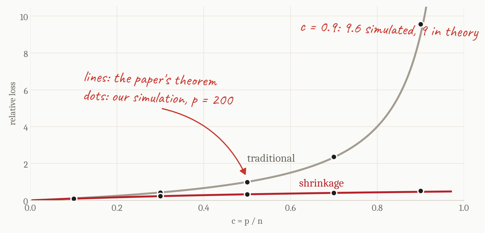
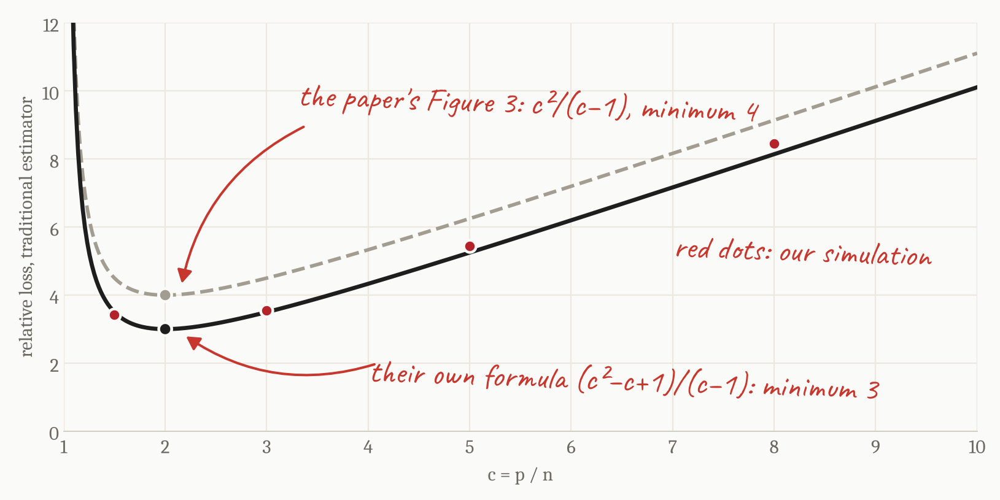
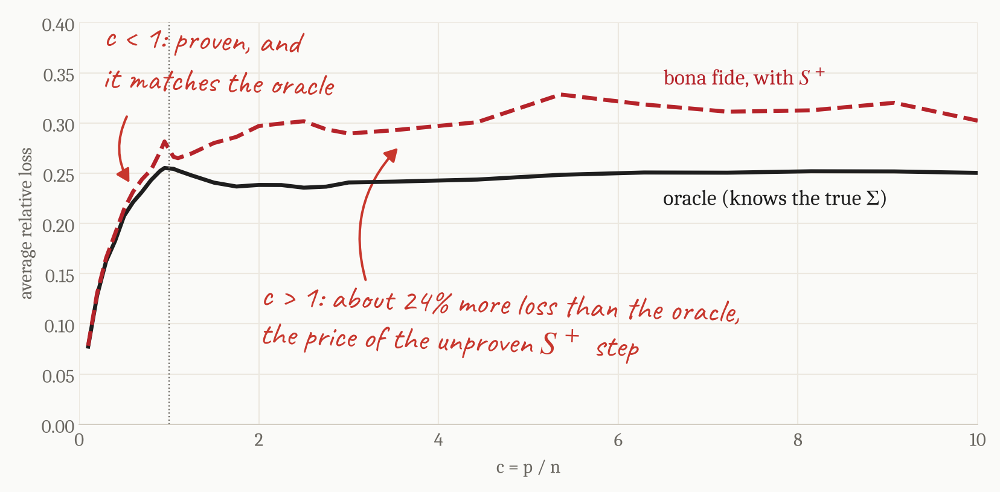
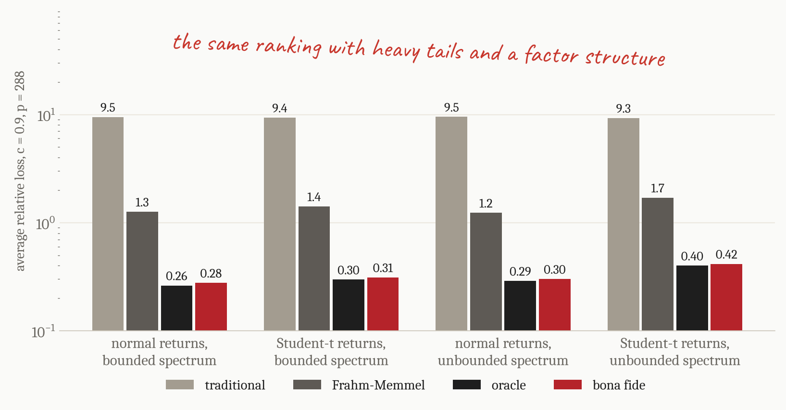
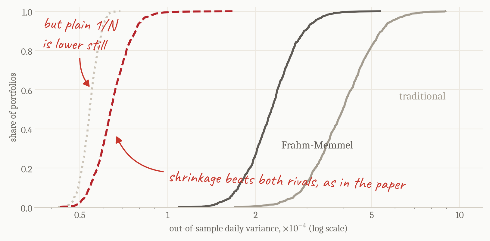
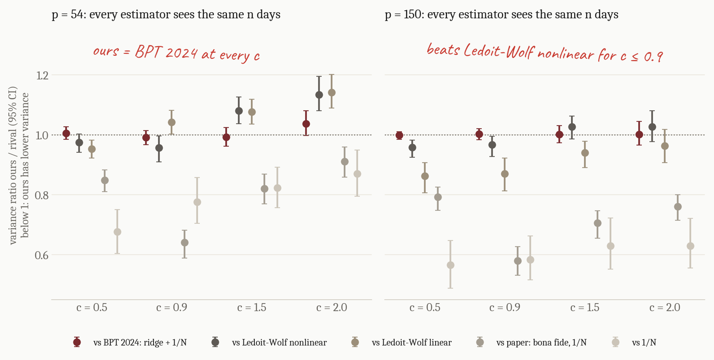
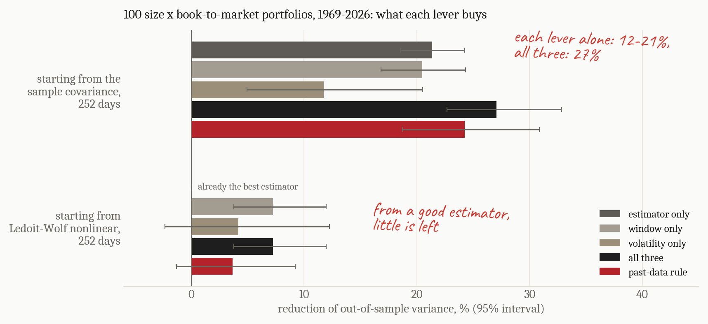
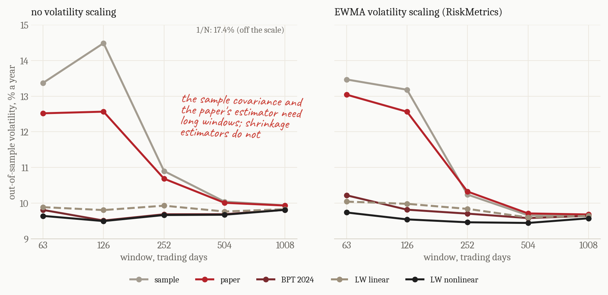
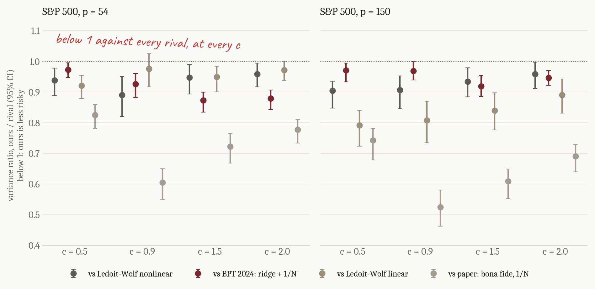
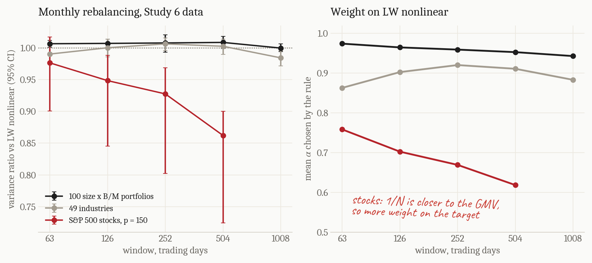

# Minimum-variance portfolios with little data

A replication and extension of Bodnar, Parolya & Schmid (2018), *Estimation of the global minimum variance
portfolio in high dimensions*, European Journal of Operational Research 266(1) ([arXiv 1406.0437](paper/1406.0437v2.pdf)).

**The paper.** To build the least risky portfolio you need the covariance matrix of returns. With p stocks and only
n days of data, the sample estimate is noisy, and the portfolio built from it is far riskier than it looks. The extra
risk depends only on c = p/n: at c = 0.9 it is nine times the minimum. The fix is to mix that portfolio with a
simple one, equal weights 1/N, and let random-matrix theory pick the mix from the data.

**What we did.** The authors published no code, so we rebuilt everything from the formulas. Studies 1–4 check the
paper; Studies 5–7 try to improve on it.

| | Result |
|---|---|
| 1. Theorems | Hold: our simulation lands on the formulas |
| 1. Figure 3 | Plots the wrong curve: the minimum loss for c > 1 is 3, not 4 |
| 2. More stocks than days (c > 1) | The practical estimator is not optimal, as claimed: about 24% more extra risk than the oracle |
| 3. Simulation study | Reproduces in all settings |
| 4. S&P 500 | Reproduces, but plain 1/N, which the paper left out, is as good or better for c ≥ 0.9 |
| 5. Ridge base, extra target | Ridge base: 9–42% less risk than the paper. A second target adds nothing |
| 6. Estimator, history or volatility? | A good shrinkage estimator does most of the work; the rest adds at most 7% |
| **7. Ledoit-Wolf nonlinear + 1/N** | **On S&P 500 stocks: 4–11% less risk than the strongest rival** |

---

## 1. Do the theorems hold?

The theorems are exact limits, so a correct implementation must land on them. We simulate the paper's design
(p = 200, 100 samples per c) and compare.

- They hold. Traditional estimator at c = 0.9: 9.6 simulated, 9 in theory. Shrinkage: 0.51 against 0.47.
- The paper's Figure 3 shows c²/(c−1) instead of its own formula (c²−c+1)/(c−1). The text repeats the figure's
  "minimum of about 4"; the formula and our simulation give 3.




## 2. The unproven step

For c > 1 the sample covariance cannot be inverted. The theorem uses an oracle inverse that needs the true
covariance; in practice the paper plugs in the pseudo-inverse S⁺ and calls the fit "perfect" based on simulations.

- Below c = 1 the practical estimator matches the oracle (4% apart).
- Above c = 1 it puts too little weight on the data (α near 0 instead of 0.05–0.10) and its loss is about 24% above
  the oracle at every c. Still ten times better than the traditional estimator.



## 3. The simulation study

The paper's Figures 7–14: normal and heavy-tailed returns, with and without a market factor, c from 0.1 to 1.8,
p up to 288. The ranking reproduces everywhere: shrinkage ≈ oracle ≪ Frahm-Memmel < traditional.



## 4. S&P 500, with the benchmark the paper left out

The paper's real-data test: 1000 random portfolios of 54 stocks, April 2013 – March 2014, rolling window, one-day
holding. We added 1/N, the target itself.

- Shrinkage beats the traditional estimator and Frahm-Memmel, as in the paper.
- But 1/N has lower risk than shrinkage in 95% of portfolios at c = 0.9, ties at c = 1.5 and 2, and loses only at
  c = 0.5. It has the higher Sharpe ratio two times out of three.
- The problem is the base portfolio, not the target: near c = 1 the sample GMV portfolio is too noisy.



## 5. A better base: ridge, and a second target

We replace the base by a ridge portfolio (S + ηI)⁻¹1 and add inverse-variance weights as a second target; η and
the mix are chosen by a random-matrix estimate of out-of-sample variance. Ridge with 1/N alone turned out to be
the authors' own later method (Bodnar, Parolya & Thorsén 2024, "BPT 2024"), so we treat it as a rival. Every
estimator sees the same days; S&P 500 2013–2018, p = 54 and 150.

- Ridge beats the paper's estimator by 9–42% at every c.
- The second target adds nothing: ours and BPT 2024 are indistinguishable.
- Against Ledoit-Wolf nonlinear shrinkage it is mixed: 3–4% better for p = 150 at c ≤ 0.9, 8–13% worse for p = 54
  at c ≥ 1.5.



## 6. Which lever matters: estimator, history or volatility?

A practitioner can change the estimator, the amount of history, or model changing volatility. We test every
combination on 57 years of Kenneth French portfolios (no survivorship bias, several crises), monthly rebalancing.

- Starting from the sample covariance on one year, a better estimator cuts variance by 21% and a better history by
  20%; all three levers together by 27%.
- Starting from Ledoit-Wolf nonlinear, little is left: at most 7%, and nothing reliable in crises.
- Volatility scaling helps on one data set, hurts on the other, and multiplies turnover by 1.5–3.




## 7. Our estimator: nonlinear shrinkage + the target

Ledoit-Wolf nonlinear shrinkage is the best estimator that treats every direction alike. But the GMV problem has
one special direction, the vector of ones, and that is exactly what the paper's target 1/N uses. So we mix them:

  w = α · w(Ledoit-Wolf nonlinear) + (1 − α) · 1/N

α is chosen at each rebalance as the mix with the lowest risk over the past year, using past data only.

- **S&P 500 (Study 5 setting):** 4–11% less risk than Ledoit-Wolf nonlinear and 3–13% less than BPT 2024, at
  every c, with 54 and 150 stocks, including the cases where ridge lost. Against Ledoit-Wolf nonlinear the gain
  shows in both halves of the period, though within a single half some intervals touch 1.
- **French portfolios:** a tie with Ledoit-Wolf nonlinear (within 1.6%). Here 1/N is three times riskier than
  the GMV, and the rule learns to put almost all weight on Ledoit-Wolf (α ≈ 0.95). On single stocks it puts
  about 30% on 1/N, as the paper's formula predicts: the riskier the target, the less weight it gets.




---

## Limits

The S&P 500 sample is one calm bull market with survivorship bias. French portfolios are not directly investable.
Costs are proportional, there is no short-sale constraint, and the GMV portfolios trade a lot (over 100% a month).

## Data

- **Simulations:** the paper's designs (Haar eigenvectors), plus a one-factor market and a "neutral" covariance
  taken from 200 real S&P 500 stocks.
- **S&P 500:** Kaggle "S&P 500 stock data" (camnugent), daily prices 2013–2018 of the 505 index members in 2018.
  The paper's window gives exactly its T = 230 days; 471 stocks have a full history (the paper has 417).
- **Kenneth French library:** daily value-weighted returns of 100 size × book-to-market portfolios (95 complete
  from July 1963) and 49 industries (from March 1971), with the risk-free rate, to September 2026. Built from CRSP,
  so no survivorship bias. Details in [data/french_info.txt](data/french_info.txt).

## Run

```
pip install -r requirements.txt
python -m gmv.data                                    # download data (~45 MB)

python -m studies.study1_theory                       # 10 s
python -m studies.study2_pseudoinverse                # 1 min
python -m studies.study3_simulations run normal bounded   # 3 min each: normal|t5 x bounded|unbounded
python -m studies.study3_simulations plot
python -m studies.study4_sp500                        # 5 min
python -m studies.study5_ridge validate               # 15 s
python -m studies.study5_ridge sim                    # 5 min
python -m studies.study5_ridge sp500 54 200           # 10 min
python -m studies.study5_ridge sp500 150 100          # 15 min
python -m studies.study5_ridge plot
python -m studies.study6_levers check                 # 5 s
python -m studies.study6_levers run ff100             # also ind49 (10 s), sp500 (8 min)
python -m studies.study6_levers weekly
python -m studies.study6_plot                         # 2 min
python -m studies.study7_goldilocks run ff100         # also ind49, sp500
python -m studies.study7_goldilocks table
python -m studies.study7_goldilocks study5            # needs the Study 5 S&P 500 runs
python -m studies.study7_goldilocks plot

python tests/test_study5.py && python tests/test_study6.py
```

## Layout

```
gmv/            shared code
  estimators.py   the paper's estimators, ridge, Ledoit-Wolf, EWMA volatility
  theory.py       the paper's asymptotic formulas
  designs.py      covariance matrices for simulations
  backtest.py     look-ahead-safe access, drifting weights, bootstrap and Newey-West
  data.py         download and load data
  style.py        chart style
studies/        one script per study
results/studyN/ tables (.csv) and figures (.png) of each study
tests/          no look-ahead, reductions to the paper's formulas
paper/          the paper
```

<details>
<summary>Two numerical details the paper does not mention</summary>

- The oracle inverse (2.16), Σ^(-1/2)(XXᵀ)⁺Σ^(-1/2), inverts n·S, not S. The weights do not care, but the estimate
  of R_b in Theorem 2.3(b) does, so we include the factor n.
- A singular S has eigenvalues of order 10⁻¹⁶. numpy's default cut-off inverts some of them and the weights blow up
  (we saw losses of 40,000); we cut at 10⁻¹⁰ of the largest eigenvalue.
</details>

<details>
<summary>Ridge: the variance estimate (Study 5)</summary>

With A = (S + ηI)⁻¹, m = tr A / p, a₂ = tr A² / p, x = 1 − c + cηm, x′ = cm − cηa₂, D = 1 − c + cη²a₂,
q₂ = (x·a₂ − x′m)/D:

- 1ᵀAΣb ≈ (1 − η·1ᵀAb) / x
- 1ᵀAΣA1 ≈ (1ᵀA1 − η·1ᵀA²1) / D / (1 − c(1 − 2ηm + η²q₂))
- bₖᵀΣbⱼ ≈ bₖᵀS bⱼ

η is chosen on a grid of 41 values. At a fixed η the estimate is within −5% to +10% of the truth; at the chosen η
it is optimistic, so we report only realised losses.
</details>
