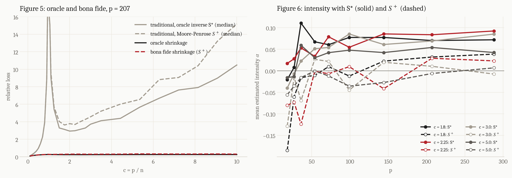
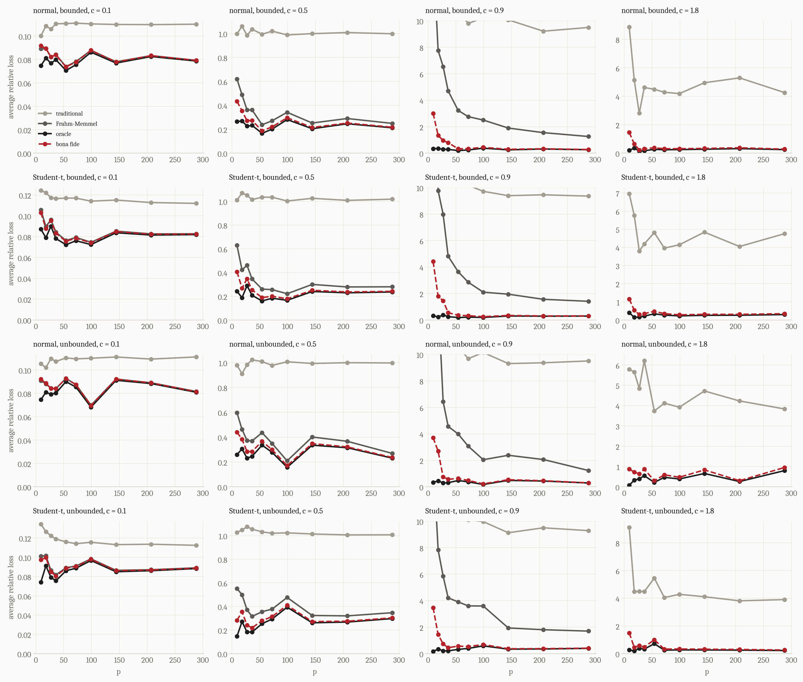
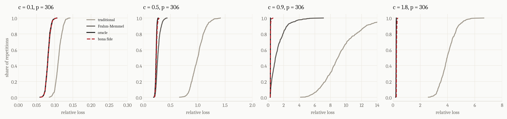
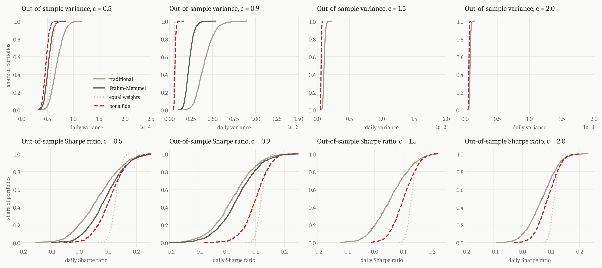

# Shrinkage estimation of the global minimum variance portfolio: a replication on simulated and S&P 500 data

This project replicates and tests the paper by Bodnar, Parolya & Schmid (2018), *Estimation of the global
minimum variance portfolio in high dimensions*, European Journal of Operational Research 266(1), 371–390
(arXiv 1406.0437, in `paper/`). The paper asks how to build the least risky portfolio when the number of
stocks p is comparable to the number of observations n, or larger.

- **The traditional estimator breaks.** Plugging the sample covariance matrix S into the formula of the
  global minimum variance (GMV) portfolio gives a portfolio whose real risk exceeds the minimum by a factor
  that depends only on c = p/n: the relative loss tends to c/(1−c) for c < 1, and to (c²−c+1)/(c−1) for c > 1.
- **The fix is a mix.** The paper mixes the sample GMV portfolio with a simple target b (here equal weights),
  ŵ = α·(sample GMV) + (1−α)·b, and derives the α that minimises the out-of-sample variance. Using random
  matrix theory, the optimal α converges to a number that depends only on c and on the relative loss of the
  target R_b, and R_b can be estimated from the data. The result is the "bona fide" estimator. It needs only
  four finite moments and allows an unbounded largest eigenvalue (a factor model).
- **For c > 1 one step is not proven.** The theory is built on an oracle generalised inverse S* that needs
  the true Σ; the usable estimator plugs in the Moore-Penrose inverse S⁺ and is supported by simulation only.

The paper backs this with a simulation study and with daily returns of S&P 500 stocks from April 2013 to
March 2014, where the shrinkage estimator has the lowest out-of-sample variance and the highest Sharpe ratio.

## Why these studies

The authors did not publish code, so we rebuilt everything from the formulas. We first check that our code
reproduces the theorems (Study 0); the theorems are exact limits, so a correct implementation must land on
them. We then test the step the authors leave unproven (Study 1), rerun their simulation study (Study 2),
and their empirical study, adding the one benchmark they did not report: the target portfolio itself,
equal weights (Study 3).

## Data

**Simulations** use the paper's designs. Figures 1–4: p = 200, eigenvalues 20% equal to 3, 40% to 1, 40% to
0.5. Figures 5–14: eigenvalues 1/9 equal to 2, 4/9 to 5, 4/9 to 10 (bounded spectrum), or the same with the
largest eigenvalue set to p (unbounded spectrum, a one-factor structure). Eigenvectors are drawn from the
Haar measure, one population matrix per dimension. Returns are normal or Student-t with 5 degrees of freedom,
rescaled to unit variance.

**S&P 500.** The Kaggle dataset "S&P 500 stock data" (camnugent), daily prices of the 505 companies in the
index in February 2018, February 2013 to February 2018, from its public mirror on GitHub (`fetch_sp500.py`).
The paper's window, 22 April 2013 to 19 March 2014, gives exactly the paper's T = 230 daily returns. 471
stocks have a complete history in the window; the paper has 417, because its list of constituents is from
an earlier date. Both samples keep only stocks that traded through the whole window, so both carry
survivorship bias. We use simple returns. The largest absolute daily return is 33.5% (Incyte), a genuine
price move; no stock splits occur in the window.

## Method

All estimators are in `common.py`, written from the paper's equations:

- **Traditional:** S⁻¹1 / 1ᵀS⁻¹1, with the sample covariance (2.2) (divisor n); the Moore-Penrose inverse S⁺
  when S is singular.
- **Bona fide shrinkage** (2.29)–(2.31), target b = 1/p, with S⁻¹ or S⁺.
- **Oracle shrinkage** (2.10) and (2.19): the optimal α computed with the true Σ, with S⁻¹ for c < 1 and the
  oracle inverse S* for c > 1.
- **Frahm & Memmel (2010)**, the benchmark (3.1), defined for c < 1 only.
- **Performance:** the relative loss (wᵀΣw − σ²_GMV)/σ²_GMV in simulations; out-of-sample variance and Sharpe
  ratio (4.1) on real data.

Two numerical details the paper does not mention: (1) the oracle inverse is written in (2.16) as
Σ^(-1/2)(XXᵀ)⁺Σ^(-1/2), which is a generalised inverse of n·S, not of S; the GMV weights do not depend on the
factor n, but the estimate of R_b in Theorem 2.3(b) does, so we include it. (2) A singular S has eigenvalues
of order 10⁻¹⁶ that numpy's default cut-off can treat as non-zero and invert, which blows up the weights
(we saw losses of 40,000 before fixing it); we cut at 10⁻¹⁰ of the largest eigenvalue.

## How to run

```
pip install -r requirements.txt
python fetch_sp500.py                          # data (about 30 MB download)
python study0_theory.py                        # ~10 s
python study1_pseudoinverse.py                 # ~1 min
python study2_simulations.py run normal bounded    # ~3 min per setting, four settings:
python study2_simulations.py run t5 bounded        #   normal / t5  x  bounded / unbounded
python study2_simulations.py run normal unbounded
python study2_simulations.py run t5 unbounded
python study2_simulations.py plot
python study3_sp500.py                         # ~5 min
```

Every study writes a table (`results/studyN.csv`), an overview figure (`results/studyN.png`), and one-chart
figures for the presentation (`results/slides/`), in the presentation's style (fonts in `fonts/`).

---

## Study 0 — Do the paper's theorems hold, and does our code reproduce them?
**Why:** the theorems are exact limits. If our estimators are right, a large simulation lands on the curves;
if it does not, nothing that follows can be trusted.

**What we did:** in the paper's design for Figures 1–4 (p = 200), simulated 100 samples for each of ten values
of c from 0.1 to 8 and compared the average relative loss and the estimated α with the formulas.

**What it showed:**
- The theorems hold. The traditional estimator's loss is 0.111, 0.990 and 9.57 at c = 0.1, 0.5, 0.9 against
  0.111, 1.000 and 9.0 in theory; the shrinkage loss is 0.091, 0.333, 0.513 against 0.091, 0.329, 0.465. The
  estimated α matches α* to the second decimal for c < 1.
- The equal-weight target in this design has R_b = 0.49, so the shrinkage loss approaches 0.47 as c → 1,
  in line with the paper's "always smaller than 0.5".
- **The paper's Figure 3 plots the wrong curve.** It shows c²/(c−1), the ratio of variances, not the relative
  loss (c²−c+1)/(c−1), which is one less. The text repeats the figure's "minimum of about 4 at c = 2"; the
  paper's own formula, and our simulation (3.02 at c = 2), give 3.
- The paper's Figure 4 peaks at about 0.09. With this design's R_b = 0.49 the formula gives 0.14 (our oracle:
  0.145). We could not find the source of the difference.
- For c > 1 the bona fide estimator with S⁺ puts too little weight on the data: α of 0.03 to 0.11 against
  0.06 to 0.14 in theory, and a loss 16–31% above the oracle.


## Study 1 — The unproven step: S⁺ in place of S* for c > 1
**Why:** for c > 1 the theorem is proven for the oracle inverse S*, which needs the true Σ, and the
estimator people can use plugs in S⁺. The paper supports the swap with two figures (5 and 6) and calls the
fit "perfect".

**What we did:** reproduced Figure 5 (p = 207, c from 0.1 to 10, 40 samples per c) and Figure 6 (the mean
estimated α with S⁺ and with S*, for c ∈ {1.8, 2.25, 3, 5} and p up to 288, 200 samples each).

**What it showed:**
- For c < 1, where the theory is proven, bona fide and oracle agree: the bona fide loss is 4% above the
  oracle on average.
- For c > 1 they do not: the bona fide loss is **24% above the oracle** on average (0.27–0.33 against
  0.24–0.25), and the gap does not shrink as c grows.
- The reason is the intensity. With S* (and the factor n, see Method) the estimated α converges to the
  oracle's as p grows (at p = 288: 0.072, 0.092, 0.085, 0.042 against 0.076, 0.099, 0.087, 0.048). With S⁺
  it stays near zero (0.039, 0.023, −0.008, 0.007), and is often negative for small p. The paper's own
  Figure 6 shows the same gap, smaller in size.
- The traditional estimator with S⁺ is worse than with S* (3.8 against 2.9 at c = 2), as in the paper.
- The shrinkage estimator still beats the traditional one by a factor of 10 or more at every c, so the
  practical conclusion survives; what fails is the claim that S⁺ attains the optimum.



## Study 2 — The simulation study
**Why:** the paper's claims of distribution-freeness and robustness to factor structure rest on this study.

**What we did:** the paper's Figures 7–14: four settings (normal or Student-t returns, bounded or unbounded
spectrum), c ∈ {0.1, 0.5, 0.9, 1.8}, p from 9 to 288 with 300 samples per point, and 500 samples at
p = 306 for the distribution of the loss (the paper uses 1000).

**What it showed:**
- The ranking reproduces in all 16 combinations: bona fide shrinkage ≈ oracle < Frahm-Memmel < traditional.
  For normal returns and a bounded spectrum at p = 288 the average loss is 0.28 (bona fide), 0.26 (oracle),
  1.26 (Frahm-Memmel) and 9.5 (traditional) at c = 0.9, and 0.22, 0.21, 0.25, 1.00 at c = 0.5.
- Heavy tails and a factor structure change little, as the paper says: at c = 0.9 the bona fide loss is
  0.28, 0.31, 0.30 and 0.42 in the four settings, within 6% of the oracle.
- For c = 1.8 the gap to the oracle of Study 1 shows again: the bona fide median loss at p = 306 is 10–16%
  above the oracle in the four settings.
- For the smallest portfolios (p = 9, n = 10 at c = 0.9) our averages are higher than the paper's figures
  (traditional 30, Frahm-Memmel 15, bona fide 3.0). The loss has a very heavy tail there; a few samples give
  losses in the hundreds or thousands. The medians (5.1, 3.6, 0.52) are close to the paper's averages, so the
  difference is how the tail was sampled, not the method.
- In the unbounded design one population matrix is drawn per p, and R_b depends on how the dominant
  eigenvector lines up with equal weights. At p = 288 and c = 1.8 this draw gives an oracle loss of 0.80
  for all 300 samples. The paper's figures share this feature.




## Study 3 — S&P 500 stocks, and the benchmark the paper left out
**Why:** this is the only test on real data, and it compares the shrinkage estimator only with the
traditional estimator and Frahm-Memmel, never with its own target, the equal-weight portfolio. If the
target alone does as well, the estimation adds nothing.

**What we did:** as in the paper: 1000 random portfolios of 54 stocks; weights estimated on a rolling window
of n = 108, 60, 36, 27 days (c = 0.5, 0.9, 1.5, 2), held for one day; out-of-sample variance and Sharpe ratio
by (4.1). We added the equal-weight portfolio and counted, portfolio by portfolio, how often shrinkage wins.

**What it showed:**
- The paper's ranking reproduces, with similar levels. Median daily variance at c = 0.5: 4.7, 5.1 and
  6.7 ×10⁻⁵ for shrinkage, Frahm-Memmel and traditional (the paper's Figure 15: about 5, 6 and 8 ×10⁻⁵). At
  c = 0.9: 6.4, 22.7 and 39.8 ×10⁻⁵. Shrinkage has the lower variance than both in more than 99% of
  portfolios at every c, and the higher Sharpe ratio in 87–95%.
- **Equal weights do as well or better.** At c = 0.9 the equal-weight portfolio has a lower variance than
  shrinkage in 95% of portfolios (median 5.4 against 6.4 ×10⁻⁵); at c = 1.5 and 2 the two are tied (48% and
  54%); only at c = 0.5 does shrinkage win clearly (98%).
- On the Sharpe ratio equal weights win at every c: shrinkage is higher in only 26–35% of portfolios
  (median daily Sharpe 0.11–0.13 for equal weights against 0.09–0.11).
- This is what the formula predicts for a short window: when c is large, α is small and the shrinkage
  portfolio is mostly the target. With one year of data in a calm market the remaining weight on the data
  does not pay.



---

## What reproduces and what does not

| Claim of the paper | Result |
|---|---|
| Loss of the traditional estimator c/(1−c), c < 1 | Reproduces (Study 0) |
| Loss for c > 1 with a minimum of about 4 (Figure 3) | Formula reproduces; figure and text are off by one: the minimum is 3 (Study 0) |
| Optimal α and the oracle shrinkage loss | Reproduce (Study 0) |
| Bona fide estimator attains the oracle for c < 1 | Reproduces, within 4–6% (Studies 1, 2) |
| S⁺ in place of S* for c > 1 works "perfectly" | Does not: α is biased towards 0, loss 10–24% above the oracle (Studies 0–2) |
| Ranking robust to heavy tails and a factor model | Reproduces (Study 2) |
| On S&P 500, shrinkage beats Frahm-Memmel and traditional | Reproduces (Study 3) |
| Shrinkage improves on simple strategies in practice | Not shown by the paper; equal weights do as well or better for c ≥ 0.9 (Study 3) |

## Next

The replication suggests three improvements to test: (1) an estimator for c > 1 that removes the bias of S⁺,
for example a regularised inverse whose limit is known from random matrix theory; (2) shrinking towards
several targets at once (equal weights, the previous period's weights, a factor portfolio), for which the
same theory gives the optimal weights from a small linear system; (3) a longer test on the full 2013–2018
sample, with the comparisons the paper leaves out: equal weights, Ledoit-Wolf covariance shrinkage, a
no-short-sale constraint, and turnover.

## Files

| File | What it does |
|---|---|
| `common.py` | estimators, covariance designs, theory formulas, chart style |
| `fetch_sp500.py` | downloads the S&P 500 data and builds the returns in the paper's window |
| `study0_theory.py` … `study3_sp500.py` | one study each, as above |
| `results/` | tables (`.csv`), overview figures (`.png`), raw simulation output (`.npz`) |
| `results/slides/` | one chart per slide, for the presentation |
| `fonts/` | Caladea and Caveat (SIL Open Font License), used by the charts |
| `paper/` | the paper (arXiv 1406.0437v2) |
