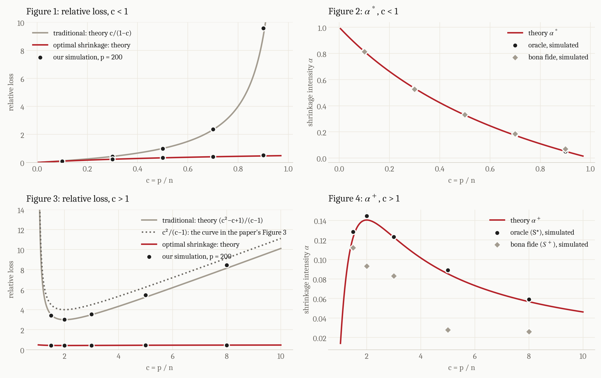
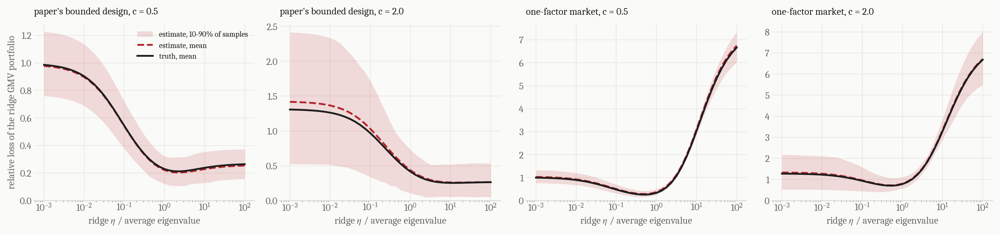
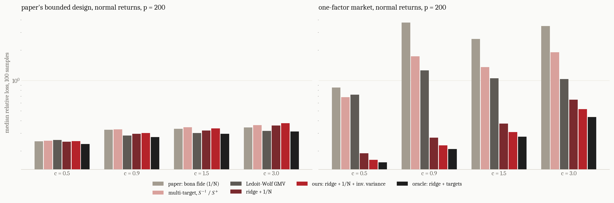
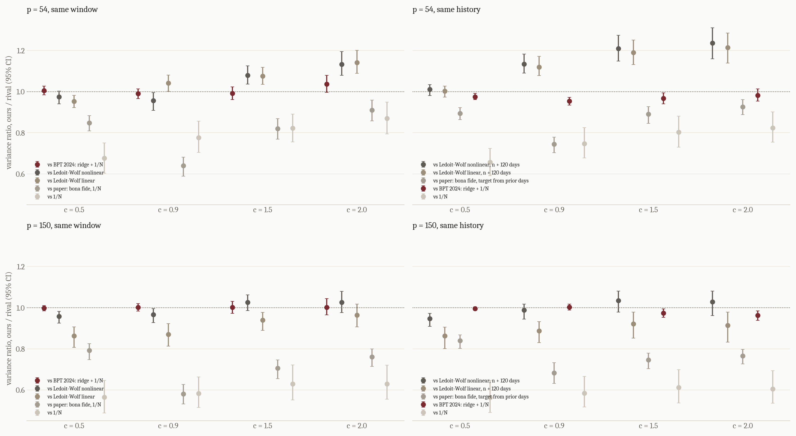
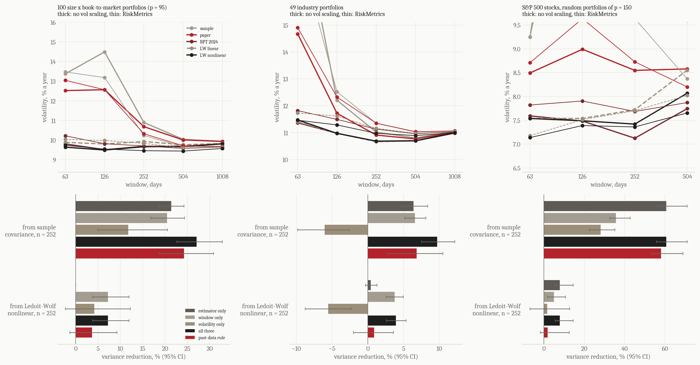
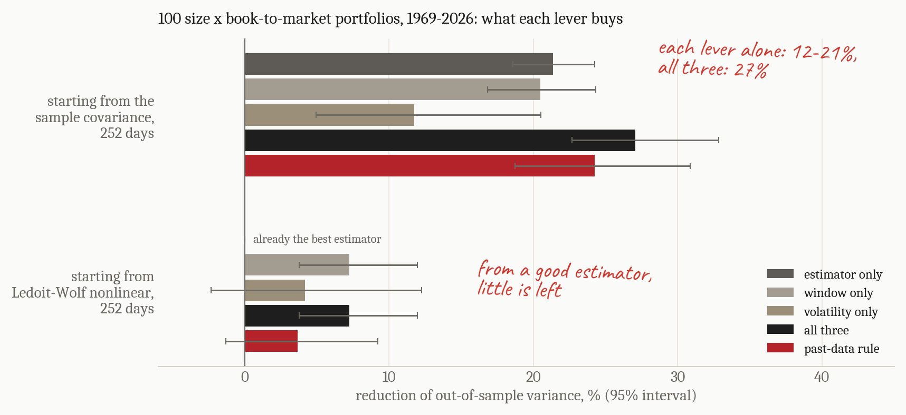
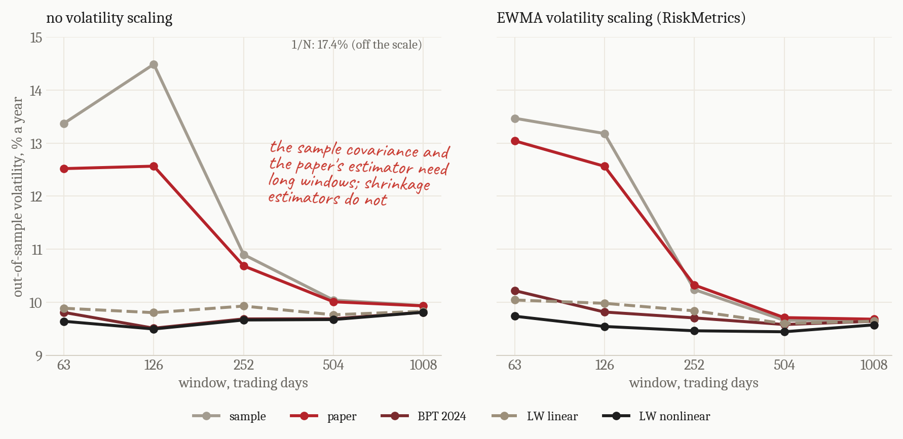
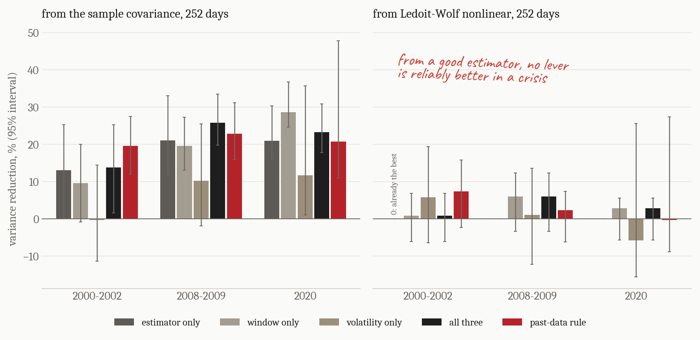

# Shrinkage estimation of the global minimum variance portfolio: a replication on simulated and S&P 500 data

This project replicates and tests the paper by Bodnar, Parolya & Schmid (2018), *Estimation of the global
minimum variance portfolio in high dimensions*, European Journal of Operational Research 266(1), 371–390
(arXiv 1406.0437, in `paper/`). The paper asks how to build the least risky portfolio when the number of
stocks p is comparable to the number of observations n, or larger.

- **The traditional estimator breaks.** Plugging the sample covariance matrix S into the formula of the
  global minimum variance (GMV) portfolio gives a portfolio whose real risk exceeds the minimum by a factor
  that depends only on c = p/n: the relative loss tends to c/(1−c) for c < 1, and to (c²−c+1)/(c−1) for c > 1.
- **The fix is a mix.** The paper mixes the sample GMV portfolio with a simple target b (here equal weights),
  ŵ = α·(sample GMV) + (1−α)·b, and derives the α that minimises the out-of-sample variance. Using random
  matrix theory, the optimal α converges to a number that depends only on c and on the relative loss of the
  target R_b, and R_b can be estimated from the data. The result is the "bona fide" estimator. It needs only
  four finite moments and allows an unbounded largest eigenvalue (a factor model).
- **For c > 1 one step is not proven.** The theory is built on an oracle generalised inverse S* that needs
  the true Σ; the usable estimator plugs in the Moore-Penrose inverse S⁺ and is supported by simulation only.

The paper backs this with a simulation study and with daily returns of S&P 500 stocks from April 2013 to
March 2014, where the shrinkage estimator has the lowest out-of-sample variance and the highest Sharpe ratio.

## Why these studies

The authors did not publish code, so we rebuilt everything from the formulas. We first check that our code
reproduces the theorems (Study 0); the theorems are exact limits, so a correct implementation must land on
them. We then test the step the authors leave unproven (Study 1), rerun their simulation study (Study 2),
and their empirical study, adding the one benchmark they did not report: the target portfolio itself,
equal weights (Study 3).

## Data

**Simulations** use the paper's designs. Figures 1–4: p = 200, eigenvalues 20% equal to 3, 40% to 1, 40% to
0.5. Figures 5–14: eigenvalues 1/9 equal to 2, 4/9 to 5, 4/9 to 10 (bounded spectrum), or the same with the
largest eigenvalue set to p (unbounded spectrum, a one-factor structure). Eigenvectors are drawn from the
Haar measure, one population matrix per dimension. Returns are normal or Student-t with 5 degrees of freedom,
rescaled to unit variance.

**S&P 500.** The Kaggle dataset "S&P 500 stock data" (camnugent), daily prices of the 505 companies in the
index in February 2018, February 2013 to February 2018, from its public mirror on GitHub (`fetch_sp500.py`).
The paper's window, 22 April 2013 to 19 March 2014, gives exactly the paper's T = 230 daily returns. 471
stocks have a complete history in the window; the paper has 417, because its list of constituents is from
an earlier date. Both samples keep only stocks that traded through the whole window, so both carry
survivorship bias. We use simple returns. The largest absolute daily return is 33.5% (Incyte), a genuine
price move; no stock splits occur in the window.

**Kenneth French portfolios (Study 6).** Daily value-weighted returns of the 100 size × book-to-market
portfolios (95 complete series, July 1963 – September 2026) and of the 49 industry portfolios (March 1971 –
September 2026), with the daily risk-free rate, from the Kenneth French data library (`fetch_french.py`,
downloaded 16 November 2026; what was kept and why is in `data/french_info.txt`). They are built from CRSP,
which keeps delisted firms, so they have no survivorship bias.

## Method

All estimators are in `common.py`, written from the paper's equations:

- **Traditional:** S⁻¹1 / 1ᵀS⁻¹1, with the sample covariance (2.2) (divisor n); the Moore-Penrose inverse S⁺
  when S is singular.
- **Bona fide shrinkage** (2.29)–(2.31), target b = 1/p, with S⁻¹ or S⁺.
- **Oracle shrinkage** (2.10) and (2.19): the optimal α computed with the true Σ, with S⁻¹ for c < 1 and the
  oracle inverse S* for c > 1.
- **Frahm & Memmel (2010)**, the benchmark (3.1), defined for c < 1 only.
- **Performance:** the relative loss (wᵀΣw − σ²_GMV)/σ²_GMV in simulations; out-of-sample variance and Sharpe
  ratio (4.1) on real data.

Two numerical details the paper does not mention: (1) the oracle inverse is written in (2.16) as
Σ^(-1/2)(XXᵀ)⁺Σ^(-1/2), which is a generalised inverse of n·S, not of S; the GMV weights do not depend on the
factor n, but the estimate of R_b in Theorem 2.3(b) does, so we include it. (2) A singular S has eigenvalues
of order 10⁻¹⁶ that numpy's default cut-off can treat as non-zero and invert, which blows up the weights
(we saw losses of 40,000 before fixing it); we cut at 10⁻¹⁰ of the largest eigenvalue.

## How to run

```
pip install -r requirements.txt
python fetch_sp500.py                          # data (about 30 MB download)
python study0_theory.py                        # ~10 s
python study1_pseudoinverse.py                 # ~1 min
python study2_simulations.py run normal bounded    # ~3 min per setting, four settings:
python study2_simulations.py run t5 bounded        #   normal / t5  x  bounded / unbounded
python study2_simulations.py run normal unbounded
python study2_simulations.py run t5 unbounded
python study2_simulations.py plot
python study3_sp500.py                         # ~5 min
python study5_ridge_multitarget.py validate    # ~15 s
python study5_ridge_multitarget.py sim         # ~5 min
python study5_ridge_multitarget.py sp500 54 200    # ~10 min (parallel)
python study5_ridge_multitarget.py sp500 150 100   # ~15 min
python study5_ridge_multitarget.py plot
python fetch_french.py                         # Study 6 data, Kenneth French library (about 16 MB download)
python study6_levers.py check                  # ~5 s
python study6_levers.py run ff100              # ~30 s (parallel)
python study6_levers.py run ind49              # ~10 s
python study6_levers.py run sp500              # ~8 min, 100 portfolios
python study6_levers.py weekly                 # ~20 s
python study6_levers.py plot                   # ~2 min (bootstrap)
python tests/test_study5.py                   # ~1 s
python tests/test_study6.py                   # ~2 s
```

Every study writes a table (`results/studyN.csv`), an overview figure (`results/studyN.png`), and one-chart
figures for the presentation (`results/slides/`), in the presentation's style (fonts in `fonts/`).

---

## Study 0 — Do the paper's theorems hold, and does our code reproduce them?
**Why:** the theorems are exact limits. If our estimators are right, a large simulation lands on the curves;
if it does not, nothing that follows can be trusted.

**What we did:** in the paper's design for Figures 1–4 (p = 200), simulated 100 samples for each of ten values
of c from 0.1 to 8 and compared the average relative loss and the estimated α with the formulas.

**What it showed:**
- The theorems hold. The traditional estimator's loss is 0.111, 0.990 and 9.57 at c = 0.1, 0.5, 0.9 against
  0.111, 1.000 and 9.0 in theory; the shrinkage loss is 0.091, 0.333, 0.513 against 0.091, 0.329, 0.465. The
  estimated α matches α* to the second decimal for c < 1.
- The equal-weight target in this design has R_b = 0.49, so the shrinkage loss approaches 0.47 as c → 1,
  in line with the paper's "always smaller than 0.5".
- **The paper's Figure 3 plots the wrong curve.** It shows c²/(c−1), the ratio of variances, not the relative
  loss (c²−c+1)/(c−1), which is one less. The text repeats the figure's "minimum of about 4 at c = 2"; the
  paper's own formula, and our simulation (3.02 at c = 2), give 3.
- The paper's Figure 4 peaks at about 0.09. With this design's R_b = 0.49 the formula gives 0.14 (our oracle:
  0.145). We could not find the source of the difference.
- For c > 1 the bona fide estimator with S⁺ puts too little weight on the data: α of 0.03 to 0.11 against
  0.06 to 0.14 in theory, and a loss 16–31% above the oracle.



## Study 1 — The unproven step: S⁺ in place of S* for c > 1
**Why:** for c > 1 the theorem is proven for the oracle inverse S*, which needs the true Σ, and the
estimator people can use plugs in S⁺. The paper supports the swap with two figures (5 and 6) and calls the
fit "perfect".

**What we did:** reproduced Figure 5 (p = 207, c from 0.1 to 10, 40 samples per c) and Figure 6 (the mean
estimated α with S⁺ and with S*, for c ∈ {1.8, 2.25, 3, 5} and p up to 288, 200 samples each).

**What it showed:**
- For c < 1, where the theory is proven, bona fide and oracle agree: the bona fide loss is 4% above the
  oracle on average.
- For c > 1 they do not: the bona fide loss is **24% above the oracle** on average (0.27–0.33 against
  0.24–0.25), and the gap does not shrink as c grows.
- The reason is the intensity. With S* (and the factor n, see Method) the estimated α converges to the
  oracle's as p grows (at p = 288: 0.072, 0.092, 0.085, 0.042 against 0.076, 0.099, 0.087, 0.048). With S⁺
  it stays near zero (0.039, 0.023, −0.008, 0.007), and is often negative for small p. The paper's own
  Figure 6 shows the same gap, smaller in size.
- The traditional estimator with S⁺ is worse than with S* (3.8 against 2.9 at c = 2), as in the paper.
- The shrinkage estimator still beats the traditional one by a factor of 10 or more at every c, so the
  practical conclusion survives; what fails is the claim that S⁺ attains the optimum.


## Study 2 — The simulation study
**Why:** the paper's claims of distribution-freeness and robustness to factor structure rest on this study.

**What we did:** the paper's Figures 7–14: four settings (normal or Student-t returns, bounded or unbounded
spectrum), c ∈ {0.1, 0.5, 0.9, 1.8}, p from 9 to 288 with 300 samples per point, and 500 samples at
p = 306 for the distribution of the loss (the paper uses 1000).

**What it showed:**
- The ranking reproduces in all 16 combinations: bona fide shrinkage ≈ oracle < Frahm-Memmel < traditional.
  For normal returns and a bounded spectrum at p = 288 the average loss is 0.28 (bona fide), 0.26 (oracle),
  1.26 (Frahm-Memmel) and 9.5 (traditional) at c = 0.9, and 0.22, 0.21, 0.25, 1.00 at c = 0.5.
- Heavy tails and a factor structure change little, as the paper says: at c = 0.9 the bona fide loss is
  0.28, 0.31, 0.30 and 0.42 in the four settings, within 6% of the oracle.
- For c = 1.8 the gap to the oracle of Study 1 shows again: the bona fide median loss at p = 306 is 10–16%
  above the oracle in the four settings.
- For the smallest portfolios (p = 9, n = 10 at c = 0.9) our averages are higher than the paper's figures
  (traditional 30, Frahm-Memmel 15, bona fide 3.0). The loss has a very heavy tail there; a few samples give
  losses in the hundreds or thousands. The medians (5.1, 3.6, 0.52) are close to the paper's averages, so the
  difference is how the tail was sampled, not the method.
- In the unbounded design one population matrix is drawn per p, and R_b depends on how the dominant
  eigenvector lines up with equal weights. At p = 288 and c = 1.8 this draw gives an oracle loss of 0.80
  for all 300 samples. The paper's figures share this feature.


## Study 3 — S&P 500 stocks, and the benchmark the paper left out
**Why:** this is the only test on real data, and it compares the shrinkage estimator only with the
traditional estimator and Frahm-Memmel, never with its own target, the equal-weight portfolio. If the
target alone does as well, the estimation adds nothing.

**What we did:** as in the paper: 1000 random portfolios of 54 stocks; weights estimated on a rolling window
of n = 108, 60, 36, 27 days (c = 0.5, 0.9, 1.5, 2), held for one day; out-of-sample variance and Sharpe ratio
by (4.1). We added the equal-weight portfolio and counted, portfolio by portfolio, how often shrinkage wins.

**What it showed:**
- The paper's ranking reproduces, with similar levels. Median daily variance at c = 0.5: 4.7, 5.1 and
  6.7 ×10⁻⁵ for shrinkage, Frahm-Memmel and traditional (the paper's Figure 15: about 5, 6 and 8 ×10⁻⁵). At
  c = 0.9: 6.4, 22.7 and 39.8 ×10⁻⁵. Shrinkage has the lower variance than both in more than 99% of
  portfolios at every c, and the higher Sharpe ratio in 87–95%.
- **Equal weights do as well or better.** At c = 0.9 the equal-weight portfolio has a lower variance than
  shrinkage in 95% of portfolios (median 5.4 against 6.4 ×10⁻⁵); at c = 1.5 and 2 the two are tied (48% and
  54%); only at c = 0.5 does shrinkage win clearly (98%).
- On the Sharpe ratio equal weights win at every c: shrinkage is higher in only 26–35% of portfolios
  (median daily Sharpe 0.11–0.13 for equal weights against 0.09–0.11).
- The shrinkage portfolio is not simply the target in disguise. The mean intensity α the estimator uses is
  0.54, 0.18, 0.46 and 0.62 at c = 0.5, 0.9, 1.5 and 2 (`results/study3_alpha.csv`): small only at c = 0.9,
  where the factor 1 − c pushes it down. At c = 1.5 and 2 about 50–60% of the weight is on the S⁺ portfolio,
  and the mixture merely ties with 1/N. At c = 0.9 the sample GMV portfolio rests on n − p = 6 spare
  observations; its loss is above the asymptotic c/(1 − c) = 9 that the formula assumes, so even α ≈ 0.18
  puts too much weight on it. The weak base portfolio, not the idea of a target, is what costs: Study 5.


## Study 5 — Our extension, compared fairly: a ridge base and several targets
**Why:** Studies 1 and 3 locate the paper's weak point in the *base* portfolio: S⁺ biases the intensity for
c > 1, and near c = 1 the sample GMV portfolio is so noisy that 1/N beats the mixture. The paper also leaves the
choice of target open (Section 2.4). A fair test of any fix must give every estimator the same data and must
include the strongest available rivals.

**What is new, and what is not.** The ridge GMV portfolio w_η = (S+ηI)⁻¹1 / 1'(S+ηI)⁻¹1 shrunk towards the
single target 1/N, with η chosen by a random-matrix estimate of the out-of-sample variance, is the method of
Bodnar, Parolya and Thorsén (2024, JMLR); we call it **BPT 2024** and treat it as a rival. Our addition is
**several targets at once**, w = w_η + Σ_k β_k (b_k − w_η) with b = (1/N, inverse-variance weights), with η and
all β_k chosen by the random-matrix estimate (`common.ridge_terms`, `ridge_choose`), and this comparison on these
data. With the deterministic equivalent (S+ηI)⁻¹ ≍ (xΣ+ηI)⁻¹, x = 1 − c + cη·m, m = tr(S+ηI)⁻¹/p, A = (S+ηI)⁻¹:
1'AΣb ≈ (1 − η·1'Ab)/x; 1'AΣA1 ≈ (1'A1 − η·1'A²1) / D / (1 − c(1 − 2ηm + η²q₂)), with a₂ = tr A²/p,
x' = cm − cηa₂, D = 1 − c + cη²a₂, q₂ = (x·a₂ − x'm)/D; b_k'Σb_j ≈ b_k'S b_j. The best β for each η solves a K×K
system; η comes from a fixed grid of 41 values. With one target and η → 0 the estimator is the paper's (2.26)
(tested, `tests/test_study5.py`).

**What we did:**
1. *Checks of the machinery* (`validate`). (a) The variance estimate of w_η against the truth over the η grid,
   three designs, c = 0.5 and 2, 100 samples. (b) The inverse-variance target built *inside* the estimation
   window, which breaks the independence the theory assumes: the bias of its terms and the true loss of the
   result, for a target from the whole window, from its first half, and from an independent earlier sample;
   p = 54 and 150, c = 0.5–2, 60 samples, three designs. (c) Our implementation of the analytical nonlinear
   shrinkage of Ledoit and Wolf (2020, Annals of Statistics 48(5), "Analytical nonlinear shrinkage of
   large-dimensional covariance matrices") against its oracle (the sample eigenvectors with the best
   eigenvalues u_i'Σu_i).
2. *Two information regimes*, on the same portfolios and the same evaluation days:
   - **same window**: every estimator sees only the last n days: 1/N, inverse variance, the paper's estimator,
     Ledoit-Wolf linear and nonlinear GMV, BPT 2024, and ours with the inverse-variance target from the first
     half of the window (the version chosen in simulation, see below);
   - **same history**: every estimator may use the last n + 120 days: Ledoit-Wolf linear and nonlinear on
     n + 120 days, inverse variance on n + 120 days, the paper's estimator with the inverse-variance target from
     the 120 earlier days, and ours with that target; the n-day estimators are kept for reference.

   Each estimator reads the data through an accessor that fails if it reads more rows than its regime allows
   or any row at or after day t; a test checks that the weights for day t do not change when every later row
   is replaced by NaN.
3. *Simulation*, p = 200, 100 samples per cell, normal and t₅ returns, c = 0.5, 0.9, 1.5, 3, in three designs
   with equal weight: **neutral**, Σ = the sample covariance of 200 random S&P 500 stocks over 2013–2018
   (condition number 1300, invertible without shrinkage); the paper's bounded design; our one-factor market.
   Each sample has n + 120 observations; same-window estimators see the last n. Paired tests over samples:
   the geometric mean of loss ratios and the t-statistic of the mean log ratio.
4. *S&P 500, 2013–2018*: 470 stocks with a full history; 200 random portfolios of p = 54 (evaluation
   January 2014 – February 2018, 1030 days) and 100 of p = 150 (October 2014 – February 2018, 838 days); one
   evaluation period for every c, regime and estimator. For each comparison: the ratio of the average
   out-of-sample variance, ours / rival, with a 95% moving-block bootstrap interval over days (blocks of 10
   days, 1000 resamples), and the Newey-West t-statistic of the day-by-day difference in squared deviations
   averaged over portfolios; both make the inference over time, the only independent dimension. Also: the
   two halves of the period, turnover against the drifted weights of the day before, and the variance of
   returns net of proportional costs of 5 and 10 basis points. Block length, the 120 days and the η grid were
   fixed before any evaluation; nothing was tuned on the evaluation data.

**What it showed — the machinery:**
- At a fixed η the variance estimate is close to the truth: the average bias over the grid lies between −5%
  and +10% in all three designs, for c = 0.5 and c = 2.
- **At the η and β it selects, the estimate is optimistic**, by 11–90% at p = 54 and up to 50% at p = 150 even
  with an independent target: the minimum of a noisy curve is biased downwards. The estimated loss must not be
  read as the loss one will get; we report only realised losses.
- **A target built inside the window biases b'Sb downwards by up to 13% at p = 54** (up to 8% at p = 150),
  against at most ±5% for an independent target. Taking the target from the first half of the window does not
  remove this bias (up to 12%), but gives a 2% lower true loss on average than the whole window, so it is the
  version we use. A second fix (the target's variance terms from the second half only) makes the linear system
  inconsistent and fails.
- **In simulation the in-window target beats BPT 2024 only in the market design at p = 150**: the true loss of
  ours / BPT is 0.95–1.16 in the neutral design and 1.08–1.17 in the paper's design at p = 54, 0.99–1.21 in the
  market design at p = 54, and 0.78–0.92 in the market design at p = 150. An independent target gives 0.61–1.14.
- Our nonlinear shrinkage is within 1–4% of its oracle in GMV loss (neutral design, n = 400: 0.408 against
  0.396; market, n = 400: 0.183 against 0.181). With few observations and p/n near 1 it is unstable: on the
  S&P 500 at p = 54, c = 0.9 (n = 60) its turnover is 0.90 per day, against 0.26 for the linear version.

**What it showed — simulation** (median relative loss, normal returns, c = 0.5 / 0.9 / 1.5 / 3; ratio = geometric
mean of ours / rival with its t-statistic):

| Design, same window | ours | BPT 2024 | LW nonlinear | LW linear | paper |
|---|---|---|---|---|---|
| neutral | 0.38 / 0.55 / 0.73 / 0.95 | 0.38 / 0.55 / 0.73 / 0.96 | 0.39 / 0.58 / 0.74 / 0.95 | 0.58 / 0.95 / 1.10 / 1.10 | 0.68 / 1.76 / 1.45 / 1.33 |
| paper's bounded | 0.21 / 0.25 / 0.28 / 0.32 | 0.21 / 0.24 / 0.26 / 0.28 | 0.20 / 0.25 / 0.25 / 0.26 | **0.21 / 0.23 / 0.24 / 0.25** | 0.21 / 0.26 / 0.27 / 0.28 |
| one-factor market | **0.17 / 0.25 / 0.36** / 0.69 | 0.19 / 0.27 / 0.37 / **0.64** | 0.20 / 0.32 / 0.47 / 0.96 | 0.72 / 1.21 / 1.02 / 1.04 | 0.87 / 3.90 / 2.61 / 3.67 |

- **Neutral design: ours = BPT 2024** (ratio 0.99–1.01, |t| ≤ 1.9) and close to Ledoit-Wolf nonlinear: better
  at c = 0.5 and 0.9 (0.973, t = −5.0; 0.946, t = −5.5), equal at 1.5 (0.993, t = −0.6), worse at 3 (1.056,
  t = 2.4). All three beat Ledoit-Wolf linear (0.59–0.89) and the paper (0.31–0.75) by wide margins.
- **Paper's design: ours is the worst of the shrinkage estimators** for c ≥ 0.9: 3–13% above BPT (t = 5.7 to
  8.3) and up to 33% above Ledoit-Wolf linear. With equal variances across stocks, the second target is noise.
- **Market design: ours beats BPT for c ≤ 1.5** (0.86, 0.92, 0.97; t = −20 to −3) and loses at c = 3 (1.08,
  t = 4.7); it beats Ledoit-Wolf nonlinear at every c (0.74–0.82). This design is ours, so it carries the least
  weight.
- **Same history, neutral design: Ledoit-Wolf nonlinear on n + 120 days wins clearly** (0.32 / 0.44 / 0.53 /
  0.65; ours with the earlier target is 17–40% worse, t = 17 to 21).

**What it showed — S&P 500, same window (the headline)** (ratio ours / rival of the average variance, 95%
bootstrap interval, Newey-West t):

| | c = 0.5 | c = 0.9 | c = 1.5 | c = 2 |
|---|---|---|---|---|
| p = 150 vs BPT 2024 | 0.998 [0.985, 1.010] | 1.002 [0.983, 1.020] | 1.001 [0.973, 1.030] | 1.001 [0.965, 1.044] |
| p = 150 vs LW nonlinear | **0.958 [0.925, 0.982], t = −3.5** | **0.966 [0.928, 0.995], t = −2.1** | 1.026 [0.986, 1.062], t = 1.3 | 1.026 [0.977, 1.080], t = 1.1 |
| p = 150 vs LW linear | 0.862 [0.806, 0.906], t = −6.6 | 0.870 [0.813, 0.922], t = −5.1 | 0.939 [0.890, 0.978], t = −2.8 | 0.963 [0.907, 1.018], t = −1.4 |
| p = 150 vs paper | 0.792 [0.747, 0.826], t = −9.0 | 0.580 [0.531, 0.627], t = −8.4 | 0.705 [0.655, 0.746], t = −9.7 | 0.760 [0.714, 0.800], t = −8.7 |
| p = 54 vs BPT 2024 | 1.005 [0.985, 1.027] | 0.990 [0.966, 1.013] | 0.992 [0.961, 1.024] | 1.036 [0.997, 1.080] |
| p = 54 vs LW nonlinear | 0.975 [0.941, 1.002], t = −1.7 | 0.957 [0.909, 0.996], t = −2.1 | **1.079 [1.036, 1.125], t = 3.1** | **1.133 [1.080, 1.195], t = 3.9** |
| p = 54 vs LW linear | 0.953 [0.922, 0.982], t = −3.3 | **1.042 [1.002, 1.081], t = 2.3** | **1.076 [1.035, 1.118], t = 3.3** | **1.142 [1.089, 1.201], t = 4.4** |
| p = 54 vs paper | 0.848 [0.809, 0.883], t = −7.4 | 0.640 [0.589, 0.681], t = −9.4 | 0.820 [0.769, 0.868], t = −6.7 | 0.911 [0.858, 0.958], t = −3.8 |

- **The second target adds nothing on real data: ours and BPT 2024 are indistinguishable** at every c and p
  (all intervals contain 1, ratios 0.99–1.04). The claim of the earlier version of this study, that several
  targets improve the estimator, does not survive a same-data comparison.
- **Ridge-based shrinkage (ours or BPT) beats the paper's estimator at every c and p**, by 9–42% (t ≤ −3.8), and
  1/N by 13–44%; it beats Ledoit-Wolf linear for p = 150 at c ≤ 1.5.
- **Against the strongest rival, Ledoit-Wolf nonlinear: better for p = 150 at c = 0.5 and 0.9** (by 4% and 3%),
  tied for p = 150 at c ≥ 1.5 and for p = 54 at c ≤ 0.9, **worse for p = 54 at c = 1.5 and 2** (by 8% and 13%),
  where the window has only 36 and 27 days. Ledoit-Wolf linear also beats ours for p = 54 at c ≥ 0.9.
- **Halves of the period**: the p = 150 gain over nonlinear shrinkage at c = 0.5 holds in both halves (0.973
  [0.94, 1.00] and 0.930 [0.87, 0.96]); at c = 0.9 it is 0.965 [0.93, 1.00] and 0.970 [0.90, 1.01], so neither
  half alone excludes 1. The p = 54 losses at c ≥ 1.5 appear in both halves. The gain over the paper holds in
  both halves except p = 54, c = 2, first half (0.947 [0.89, 1.01]).
- **Costs**: with 5 or 10 basis points every ratio above changes by at most 0.01. Turnover per day: ours
  0.18–0.68, BPT 0.18–0.60, Ledoit-Wolf linear 0.19–0.40, nonlinear 0.21–0.90 (0.90 at p = 54, c = 0.9), the
  paper 0.35–1.48.

**What it showed — S&P 500, same history** (ours with the inverse-variance target from the 120 earlier days):
- Against BPT 2024 on n days the earlier target helps a little: 0.954–0.982 for p = 54 (t = −1.2 to −4.6) and
  0.962–1.003 for p = 150. **But this gain comes from data BPT does not see: Ledoit-Wolf nonlinear on the same
  n + 120 days is as good or better**: for p = 150, 0.947 [0.909, 0.972] (t = −3.8) at c = 0.5 and ties at
  c ≥ 0.9 (0.988–1.035, intervals contain 1); for p = 54, a tie at c = 0.5 (1.011) and 13–24% worse at
  c ≥ 0.9 (t = 5.0 to 5.9).

**Limits:** the variance estimate is derived by deterministic equivalents and checked by simulation, not proven;
its value at the selected (η, β) is optimistic; the S&P 500 sample is one bull-market period with survivorship
bias (stocks in the index in 2018 with a full 2013–2018 history); costs are proportional and there is no
short-sale constraint.





## Study 6 — Which lever matters: the estimator, the history, or the volatility
**Why:** the paper studies one lever, the estimator, at a fixed c = p/n. A practitioner has two more: how much
history to use, and whether to follow changing volatility. Study 5 hinted that more data can matter more than a
cleverer formula. Studies 3 and 5 also rest on one five-year bull market with survivorship bias. So we measure
all three levers side by side, on long data without survivorship bias that include several crises.

**In plain words:**
- **From the textbook start (the sample covariance of the last year), the estimator and the history are the
  big levers.** On the 100 size and book-to-market portfolios, switching to a shrinkage estimator lowers the
  variance by 21%, and a better history by 20%. Following daily volatility gives 12%, with a wide
  interval. All three together give 27%. These gains appear in every subperiod and in the 2008–2009 and 2020
  crises.
- **Once you use a good shrinkage estimator, little is left.** Starting from Ledoit-Wolf nonlinear on one year,
  the best history adds 7% and volatility scaling 4% (not significant). All three together add 7%, and no lever
  is reliably better in any crisis.
- **The history matters a lot only for weak estimators.** The sample covariance and the paper's estimator need
  windows of two years or more. For the shrinkage estimators, anything from three months to four years gives
  nearly the same risk.
- **Volatility scaling (RiskMetrics) is a poor lever.** It helps a little on the 100 portfolios, hurts on the
  49 industries, and multiplies turnover by 1.5–2.9. At 25 basis points of cost it turns a Sharpe ratio of
  0.74 into −0.03. A slower version (half-life 60 days) is better, but still small.
- **The rule "use the window with the lowest risk over the past year" is safe but not magic.** From the
  textbook start it captures most of the best gain (24% against the ex-post best 27%). It does not beat
  Ledoit-Wolf nonlinear with a fixed year of data (4% [−1, 9]).

**What is new:** the comparison of the three levers on one footing, on 57 years of survivorship-free data, with
crises shown separately. Also a rule that chooses the history and the volatility setting from past data only.

**What we did:**
1. *Data* (`fetch_french.py`, `data/french_info.txt`). Kenneth French's daily value-weighted returns, built from
   CRSP, which keeps delisted firms. We downloaded them on 16 November 2026, from the CRSP 202609 database;
   the last day is 30 September 2026.
   - *100 size × book-to-market portfolios*, the main set. They start on 1 July 1963, when Compustat coverage
     begins. Five portfolios still have gaps after that date, so we drop them (ME7 BM10, ME9 BM10, ME10 BM8,
     ME10 BM9 and BIG HiBM, extreme corners that are empty in some years; BIG HiBM is empty until the end of
     the sample). That leaves p = 95.
   - *49 industries*, all complete from 12 March 1971.
   - *The S&P 500 stocks of Studies 3 and 5*: 100 random portfolios of p = 150, 2013–2018, with
     survivorship bias.
2. *Design* (`study6_levers.py`):
   - *Rebalancing and evaluation.* Rebalance every 21 trading days. Between rebalances the weights drift with
     returns, and returns are evaluated daily. All 118 configurations and 7 rules share one evaluation period
     per data set. For the 100 portfolios it runs from 13 May 1969 to 30 September 2026 (14,469 days); for the
     industries, from 7 December 1976. It starts after the longest window, the volatility warm-up
     (63 + 126 days) and the rule's one-year look-back.
   - *Lever 1, the estimator:* 1/N; inverse variance; the sample covariance (pseudo-inverse when n ≤ p); the
     paper's bona fide estimator; BPT 2024; Ledoit-Wolf linear; Ledoit-Wolf nonlinear (the implementations of
     Studies 3 and 5).
   - *Lever 2, the history:* windows of 63, 126, 252, 504 and 1008 days. For the three covariance-matrix
     estimators we add exponentially weighted estimates with half-lives of 63, 126 and 252 days over the last
     1008 days. For nonlinear shrinkage, the effective sample size takes the place of n.
   - *Lever 3, volatility:* none, or EWMA devolatilisation per asset. σ_t is computed from returns up to t−1,
     with RiskMetrics λ = 0.94, and a half-life of 60 days as a robustness check. The correlation structure is
     estimated on z = r/σ, and the forecast is Σ_t = D_t C D_t.
   - *The two weight estimators (the paper's and BPT 2024)* use the exact transformation: the GMV of D C D is
     w = D⁻¹v, where v minimises v'Cv subject to a'v = 1, a = D⁻¹1. This equals applying them to the returns
     rescaled to today's volatility (tested).
   - *The rule:* at each rebalance, choose the history and the volatility setting (none or RiskMetrics) with
     the lowest variance of realised out-of-sample returns over the previous 252 days. It is applied per
     estimator, and over all estimators ("rule: everything").
   - *Fixed in advance:* every grid value, the 21-day interval and the 252-day look-back. Nothing was tuned on
     the evaluation data. The full run takes about 10 minutes, so no grid had to be reduced. For the S&P 500
     the longest window is 504 days, because the data cover only five years.
3. *Measures and inference:*
   - annualised volatility, Sharpe ratio (excess over the Fama-French risk-free rate), turnover per rebalance
     (against the drifted weights), and volatility and Sharpe ratio net of 10 and 25 basis points;
   - for every comparison, the ratio of variances with a 95% moving-block bootstrap interval over days (blocks
     of 21 days, 1000 resamples) and the Newey-West t-statistic;
   - subperiods 1969–1989 (1976–1989 for the industries), 1990–2007 and 2008–2026, and the crises 2000–2002,
     2008–2009 and 2020;
   - the lever decomposition from two baselines, the sample covariance on 252 days and Ledoit-Wolf nonlinear
     on 252 days, without volatility scaling. "Best" means lowest variance over the full period, chosen
     **ex post**, so it is an upper bound. The rule is its ex-ante counterpart.
4. *Robustness:* weekly rebalancing for the lever configurations (100 portfolios), and the 60-day half-life.
5. *Do the paper's and BPT's formulas survive devolatilisation?* (`check`). Algebraically they hold with a in
   place of 1, as long as a is fixed. In practice σ_t comes from the last days of the same window, and z is
   standardised with estimated volatilities. We simulated GARCH(1,1) volatility per asset (0.06, 0.93) with the
   correlations of the 100 portfolios, 100 samples per window, and compared the formulas with their oracles
   under the true covariance of the next day.

**What it showed — the formulas after devolatilisation:** they hold only approximately.
- The paper's intensity α is 9–15% below its oracle (0.80 against 0.91 at n = 63; 0.95 against 1.11 at n = 252).
  Without devolatilisation it is −7% to +1% off.
- The resulting loss is 4–26% above the oracle α, against 2–4% without devolatilisation.
- BPT's estimated variance at its chosen η is about half the true one (median ratio 0.49–0.60). Without
  devolatilisation the ratio is 0.64–0.79.
- The realised loss is still much lower with devolatilisation (BPT at n = 252: 0.33 against 1.53), so we keep
  the devolatilised versions of both estimators and flag them. The lever conclusions below rest on the
  covariance estimators, for which no such formula is involved.

**What it showed — the levers** (variance reduction, %, with 95% bootstrap interval; FF100 = the 100 portfolios,
IND49 = the industries; full period unless stated):

| From the sample covariance, 252 days | FF100 | IND49 | S&P 500 |
|---|---|---|---|
| estimator only (best at 252 days) | 21 [19, 24], LW nonlinear | 6 [5, 8], LW linear | 61 [56, 71], BPT 2024 |
| window only (best history) | 20 [17, 24], EW half-life 252 | 7 [5, 8], EW half-life 126 | 36 [33, 43], EW half-life 126 |
| volatility only (RiskMetrics) | 12 [5, 21] | −6 [−10, −3] | 28 [23, 35] |
| all three (ex post best) | 27 [23, 33], LW nonlinear, EW 63 | 10 [7, 12], LW linear, EW 126 | 61 [56, 71], BPT 2024, 252 days |
| past-data rule (ex ante) | 24 [19, 31] | 7 [3, 10] | 58 [54, 69] |
| **From Ledoit-Wolf nonlinear, 252 days** | | | |
| estimator only (best at 252 days) | 0, already the best | 0 [0, 1], LW linear | 8 [6, 14], BPT 2024 |
| window only | 7 [4, 12] | 4 [3, 5] | 5 [2, 11] |
| volatility only (RiskMetrics) | 4 [−2, 12] | −6 [−9, −2] | 2 [−7, 13] |
| volatility only (half-life 60) | 7 [2, 15] | 1 [−1, 3] | 2 [−2, 10] |
| all three (ex post best) | 7 [4, 12] | 4 [3, 5] | 8 [6, 14], BPT 2024, 252 days |
| past-data rule (ex ante) | 4 [−1, 9] | 1 [−2, 4] | 2 [−2, 12] |

Annualised volatility on FF100:
- 1/N: 17.4%;
- the sample covariance on 252 days: 10.9%;
- Ledoit-Wolf nonlinear on 252 days: 9.66%;
- the past-data rule: 9.49%;
- the ex-post best of the main grid: 9.31%.

On IND49: 16.8%, 11.0%, 10.68%, 10.64% and 10.47%.

- **The window curve** (`s6_window.png`):
  - *Sample covariance on FF100* (p = 95): volatility is 13.4%, 14.5%, 10.9%, 10.0% and 9.9% for windows of 63
    to 1008 days. The paper's estimator follows the same shape (12.5% to 9.9%).
  - *BPT 2024 and both Ledoit-Wolf estimators* stay between 9.5% and 9.9% at every window.
  - *Industries:* the same picture; the sample covariance at 63 days (c = 0.78) gives 19.7%, the shrinkage
    estimators 10.5–11.5% everywhere.
  - So most of the "window" gain from the textbook start is the cure for a weak estimator, not a property of
    the data.
- **Volatility scaling:**
  - RiskMetrics helps the sample covariance on FF100 (12%), but not reliably in 1990–2007 (−1% [−8, 5]) or
    2000–2002 (0% [−11, 15]).
  - It hurts on IND49 (−6% overall). The point estimate is negative in every subperiod except 2020, and
    significantly so in 1976–1989 and 1990–2007.
  - It multiplies turnover by 1.5–2.3 on FF100 and 2.3–2.9 on IND49. Net of 25 basis points, Ledoit-Wolf
    nonlinear's Sharpe ratio on FF100 falls from 0.74 to −0.03 with it.
  - The 60-day half-life helps more and costs less (turnover ×1.0–1.4): 7% [2, 15] on top of Ledoit-Wolf
    nonlinear on FF100, but 1% [−1, 3] on IND49.
- **Subperiods and crises**, from the textbook start:
  - On FF100 the estimator and window levers lower the variance in every subperiod (16–23%) and every crisis
    (10–29%). Only in 2000–2002 do the intervals touch 0 (estimator 13% [0, 25], window 10% [−1, 20]).
  - On IND49 the gains are smaller but present in every subperiod (estimator 5–8%, window 5–7%). In 2008–2009
    the estimator gain is not significant (4% [−2, 13]).
  - From Ledoit-Wolf nonlinear, none of the main levers is significant in any crisis on FF100. The one
    exception is the robustness setting: the 60-day half-life gives 15% [7, 24] in 2000–2002, but −8% [−17, 1]
    in 2020. On IND49 the exponentially weighted history adds 5–6% in 2000–2002 and 2008–2009.
- **The rule:**
  - It chooses Ledoit-Wolf nonlinear at 72% of rebalances on FF100 (45% on IND49), usually an exponentially
    weighted or long history, and RiskMetrics scaling at 32% (11%).
  - From the textbook start it is significant in every subperiod on FF100 (19–26%). On IND49 it gives 6–8%;
    the 2008–2026 interval touches 0, and in the 2008–2009 crisis it is −3% [−22, 15].
  - Against Ledoit-Wolf nonlinear on 252 days it never wins significantly in a subperiod; in 2008–2009 on IND49
    it is 7% worse (not significant).
- **Weekly rebalancing** lowers every configuration's volatility on FF100 by 0.6–0.8 points (Ledoit-Wolf
  nonlinear, 252 days: 9.66% → 9.02%) and doubles yearly turnover. The lever ratios barely change (estimator:
  0.786 → 0.801; window: 0.795 → 0.822).
- **Costs:** the GMV portfolios of FF100 are long-short and trade a lot. Turnover per monthly rebalance is 1.3
  for Ledoit-Wolf nonlinear and 3.1 for the sample covariance on 252 days. Net of 25 basis points, their Sharpe
  ratios are 0.74 and 0.21; costs move the volatility little (9.66% → 9.77%).
- **S&P 500 2013–2018** (p = 150, evaluation 9 November 2016 to 7 February 2018, 313 days):
  - The same ranking, with larger numbers, because p = 150 is large against every window (c = 0.3–2.4).
  - From the sample covariance on 252 days (volatility 11.4%), the estimator gives 61% (BPT 2024, 7.1%), the
    history 36%, and RiskMetrics scaling 28%.
  - From Ledoit-Wolf nonlinear (7.4%), BPT 2024 is 8% better [6, 14] and the best history 5% [2, 11].
    Volatility scaling and the rule add nothing significant.
  - 1/N gives 8.6%.
  - This is one year and three months of a calm, rising market, with survivorship bias: the weakest evidence
    of the three.

**Where the results are weak or mixed:**
- The "best" history and the "all three" configuration are chosen ex post, and the intervals do not account
  for that. The rule is the honest version and gets about 90% of the best gain from the textbook start
  (FF100: 24% against 27%).
- The bootstrap intervals for 2020 are wide (one year, 12 blocks).
- Volatility scaling helps on one data set and hurts on the other.
- The S&P 500 sample is short, and it is a bull market with survivorship bias.
- French portfolios are not directly investable. Costs are charged at the portfolio level, and there is no
  short-sale constraint.







---

## What reproduces and what does not

| Claim of the paper | Result |
|---|---|
| Loss of the traditional estimator c/(1−c), c < 1 | Reproduces (Study 0) |
| Loss for c > 1 with a minimum of about 4 (Figure 3) | Formula reproduces; figure and text are off by one: the minimum is 3 (Study 0) |
| Optimal α and the oracle shrinkage loss | Reproduce (Study 0) |
| Bona fide estimator attains the oracle for c < 1 | Reproduces, within 4–6% (Studies 1, 2) |
| S⁺ in place of S* for c > 1 works "perfectly" | Does not: α is biased towards 0, loss 10–24% above the oracle (Studies 0–2) |
| Ranking robust to heavy tails and a factor model | Reproduces (Study 2) |
| On S&P 500, shrinkage beats Frahm-Memmel and traditional | Reproduces (Study 3) |
| Shrinkage improves on simple strategies in practice | Not shown by the paper; equal weights do as well or better for c ≥ 0.9 (Study 3) |
| *Our extension:* several targets (ridge base) | Does not survive: on S&P 500 with the same data it equals BPT 2024 (ratio 0.99–1.04, all 95% intervals contain 1); helps only in our market simulation or with 120 extra days, where Ledoit-Wolf nonlinear on the same days is as good or better (Study 5) |
| *Our extension:* ridge base (BPT 2024) instead of S⁻¹/S⁺ | Survives: 9–42% lower variance than the paper's estimator at every c and p (t ≤ −3.8); beats Ledoit-Wolf nonlinear only for p = 150 at c ≤ 0.9, loses to it for p = 54 at c ≥ 1.5 (Study 5) |
| *Study 6:* a better estimator is the lever that matters | Partly. From the sample covariance on one year, the estimator and the history matter about equally (variance −21% and −20% on the 100 portfolios, −6% and −7% on the industries), in every subperiod; volatility scaling matters less and is not robust (variance −12% on the portfolios, +6% on the industries). From Ledoit-Wolf nonlinear, the other levers add at most 4–7%, and nothing significant in crises (Study 6) |
| *Study 6:* choose the window and volatility setting from past data | Safe but not better: from the textbook start it lowers the variance by 24% (the ex-post best: 27%), but does not beat Ledoit-Wolf nonlinear on a fixed year (4% [−1, 9]) (Study 6) |

## Next

Study 5 settles that a second target chosen by the random-matrix estimate does not help once all estimators see
the same days, and that the ridge base (BPT 2024) is what improves on the paper. Study 6 shows that on long,
survivorship-free data a good shrinkage estimator is most of the answer: with it, the window and the volatility
model matter little. What is left:
(1) the optimism of the estimated loss at the selected η: a less noisy selection (smoothing the estimated curve,
or a closed-form η), since the oracle choice in the same family is 4–31% better in simulation;
(2) a random-matrix theory for devolatilised data, where the vector a = D⁻¹1 comes from the same window: the
formulas hold only approximately (α 9–15% too low, BPT's variance estimate about half the truth);
(3) slow volatility scaling (half-life 60 days), the one volatility setting that helped Ledoit-Wolf nonlinear on
the 100 portfolios (7% [2, 15]), needs a test on other data, since it adds nothing on the industries;
(4) turnover: the GMV portfolios of the French data trade 130% or more a month, so a turnover penalty or a
no-short-sale constraint, and individual stocks from CRSP, would make the costs realistic.

## Files

| File | What it does |
|---|---|
| `common.py` | estimators, covariance designs, theory formulas, chart style |
| `fetch_sp500.py` | downloads the S&P 500 data and builds the returns in the paper's window |
| `study0_theory.py` … `study3_sp500.py` | one study each, as above |
| `study5_ridge_multitarget.py` | our extension and its fair comparison (validation, simulation, S&P 500 in two regimes) |
| `fetch_french.py` | downloads the Kenneth French portfolios and the risk-free rate; `data/french_info.txt` records the download |
| `study6_levers.py`, `study6_plot.py` | which lever matters: backtest of every estimator, history and volatility setting; tables and figures |
| `tests/test_study5.py` | quick checks: reductions to the paper's estimator, nonlinear shrinkage, no look-ahead |
| `tests/test_study6.py` | no look-ahead (EWMA volatility and the rule included), the devolatilised GMV, drifting weights |
| `results/` | tables (`.csv`), overview figures (`.png`), raw simulation output (`.npz`) |
| `results/slides/` | one chart per slide, for the presentation |
| `fonts/` | Caladea and Caveat (SIL Open Font License), used by the charts |
| `paper/` | the paper (arXiv 1406.0437v2) |
